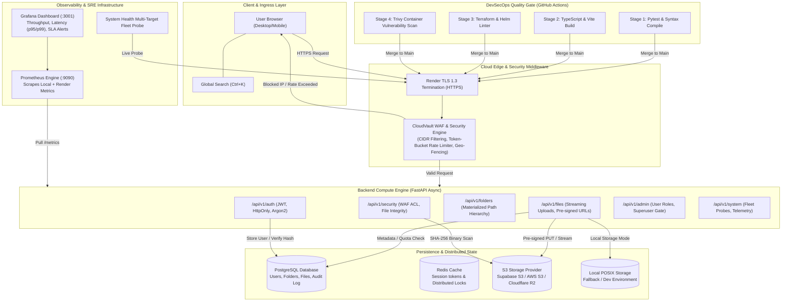
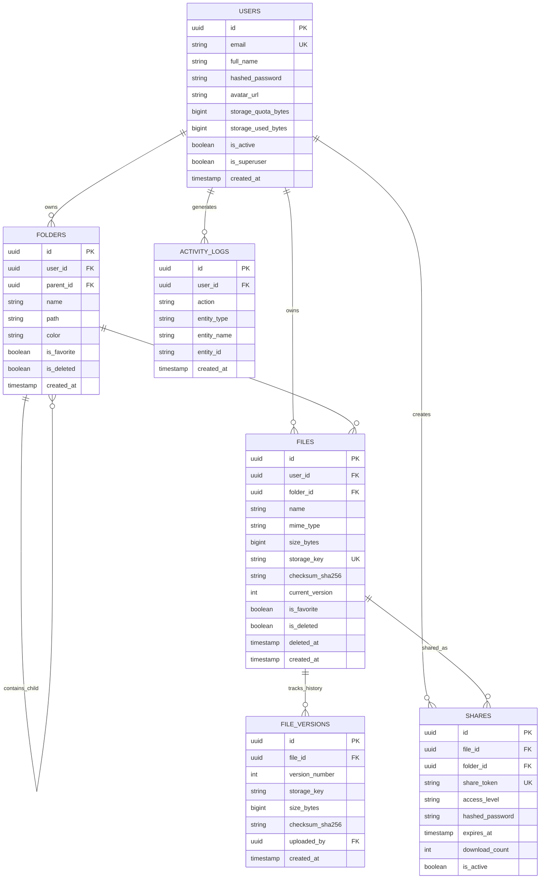

# ☁️ CloudVault: Enterprise Cloud Storage & DevSecOps Platform
## Complete Technical Architecture, Deep-Dive Specification & Interview Mastery Guide

> **Author & Architect:** Aakashdeep Dhall (`aakashdeep14122004@gmail.com`)  
> **Production Live Deployment:**  
> - **Frontend (React SPA):** [https://cloudvault-frontend-z0wb.onrender.com](https://cloudvault-frontend-z0wb.onrender.com)  
> - **Backend API & Swagger:** [https://cloudvault-backend-cazy.onrender.com](https://cloudvault-backend-cazy.onrender.com)  
> - **GitHub Repository:** `pogg144p/CloudVault`  
> **Primary Domains:** Cloud Engineering, DevOps / SRE, Distributed Storage, Full-Stack Architecture, Network Security & WAF.

---

## 📑 Table of Contents
1. [Executive Summary & Core Philosophy](#1-executive-summary--core-philosophy)
2. [End-to-End System Architecture & Topologies](#2-end-to-end-system-architecture--topologies)
3. [Component-by-Component Technical Breakdown](#3-component-by-component-technical-breakdown)
   - [3.1 Backend Application Layer (FastAPI & Async Engine)](#31-backend-application-layer-fastapi--async-engine)
   - [3.2 Storage Abstraction Engine (Local vs. S3 Protocol)](#32-storage-abstraction-engine-local-vs-s3-protocol)
   - [3.3 Direct-to-Cloud Uploads: Pre-signed URLs](#33-direct-to-cloud-uploads-pre-signed-urls)
   - [3.4 Database Schemas & Storage Modeling](#34-database-schemas--storage-modeling)
   - [3.5 Frontend Architecture & State Management (React 18 + Vite)](#35-frontend-architecture--state-management-react-18--vite)
4. [Security, Cryptography & Cloud Networking (The WAF Engine)](#4-security-cryptography--cloud-networking-the-waf-engine)
   - [4.1 Authentication & Token Mechanics (HttpOnly + Argon2id)](#41-authentication--token-mechanics-httponly--argon2id)
   - [4.2 Web Application Firewall (WAF) & CIDR Subnet Filtering](#42-web-application-firewall-waf--cidr-subnet-filtering)
   - [4.3 Anti-DDoS Token-Bucket Rate Limiter](#43-anti-ddos-token-bucket-rate-limiter)
   - [4.4 Cryptographic Data Integrity & Tamper Detection (SHA-256)](#44-cryptographic-data-integrity--tamper-detection-sha-256)
   - [4.5 Encryption in Transit & At Rest](#45-encryption-in-transit--at-rest)
5. [Telemetry, Observability & SRE Operations](#5-telemetry-observability--sre-operations)
   - [5.1 Prometheus Metrics Engine](#51-prometheus-metrics-engine)
   - [5.2 Multi-Target Fleet Monitoring (Render Cloud + Localhost)](#52-multi-target-fleet-monitoring-render-cloud--localhost)
   - [5.3 Grafana Observability Dashboard](#53-grafana-observability-dashboard)
   - [5.4 Chaos Engineering & Resiliency Testing](#54-chaos-engineering--resiliency-testing)
6. [DevOps, Cloud Infrastructure & CI/CD Pipelines](#6-devops-cloud-infrastructure--cicd-pipelines)
   - [6.1 Docker Containerization & Multi-Service Compose](#61-docker-containerization--multi-service-compose)
   - [6.2 Kubernetes Helm Chart Architecture](#62-kubernetes-helm-chart-architecture)
   - [6.3 Infrastructure as Code (Terraform AWS Modules)](#63-infrastructure-as-code-terraform-aws-modules)
   - [6.4 DevSecOps GitHub Actions Pipeline (4-Stage Quality Gate)](#64-devsecops-github-actions-pipeline-4-stage-quality-gate)
7. [Comprehensive Interview Mastery Guide (20+ Tough Questions & Answers)](#7-comprehensive-interview-mastery-guide-20-tough-questions--answers)

---

## 1. Executive Summary & Core Philosophy

**CloudVault** is not simply a file-hosting application; it is an **enterprise-grade Cloud Storage, File Collaboration, and Network Security Platform** engineered to demonstrate how production cloud systems are architected, deployed, monitored, and secured.

In consumer software, a storage service is just a box where files are dropped. In enterprise infrastructure, that same box requires:
1. **Zero-Trust Access Control & Role-Based Permissions (RBAC)**.
2. **Scalable High-Throughput Ingestion** without saturating backend API servers (Pre-signed S3 URLs).
3. **Multi-Tenant Storage Isolation & Strict Quota Reconciliations**.
4. **Active Threat Mitigation**: Ingress firewalling (CIDR subnets), DDoS throttling (Token Bucket), and automated data integrity verification (SHA-256 digests).
5. **Full-Spectrum Observability**: High-cardinality Prometheus telemetry scraped across distributed fleets (local containers + remote cloud instances).
6. **Infrastructure as Code (IaC)**: Reproducible cloud environments through Terraform and container orchestration through Kubernetes (Helm).

---

## 2. End-to-End System Architecture & Topologies



---

## 3. Component-by-Component Technical Breakdown

### 3.1 Backend Application Layer (FastAPI & Async Engine)
The backend is built with **FastAPI** on top of **Starlette** and **Uvicorn**, running Python's asynchronous event loop (`asyncio`).
* **Why FastAPI over Flask / Django?**
  * **Asynchronous I/O by Default:** When handling file streaming or database pooling, thread-blocking architectures (like standard Flask/Django) choke under concurrent uploads. FastAPI natively yields the event loop during network and disk I/O.
  * **Strict Typing via Pydantic v2:** Input request bodies and output responses are validated at microsecond speeds using Pydantic’s Rust-compiled core.

#### File Structure Organization
```
backend/
├── app/
│   ├── api/
│   │   ├── deps.py               # Dependency injection: get_db, get_current_user, get_current_active_superuser
│   │   └── v1/
│   │       ├── router.py         # Centralized API Router aggregating all endpoints
│   │       └── endpoints/
│   │           ├── admin.py      # User listing, role management (grant/revoke superuser)
│   │           ├── auth.py       # Register, login, refresh, logout, me (HttpOnly cookies)
│   │           ├── dashboard.py  # Storage breakdown, category aggregations, recent files
│   │           ├── files.py      # CRUD, multipart upload, pre-signed URLs, downloads
│   │           ├── folders.py    # Hierarchical tree, breadcrumbs, cascade delete
│   │           ├── security.py   # Firewall rules, security overview, SHA-256 integrity inspection
│   │           ├── shares.py     # Public link tokens, password protection, expiration
│   │           ├── system.py     # Fleet probes, chaos engineering, health telemetry
│   │           └── trash.py      # Soft-delete recovery bin, permanent purge
│   ├── core/
│   │   ├── config.py             # BaseSettings, dynamic CORS assembling, quota constants
│   │   ├── database.py           # AsyncSessionLocal, create_async_engine (SQLite / PostgreSQL)
│   │   ├── metrics.py            # Prometheus middleware, Counter, Histogram, metrics handler
│   │   ├── security.py           # Argon2id password hashing, JWT encoder/decoder
│   │   └── security_firewall.py  # In-memory WAF engine, CIDR matching, Token Bucket limiter
│   ├── models/                   # SQLAlchemy ORM declarative models
│   ├── schemas/                  # Pydantic request/response data contracts
│   └── services/                 # Business logic separation (FileService, StorageService, ThumbnailService)
└── main.py                       # Application factory, lifespan, CORS, WAF & Prometheus middleware
```

---

### 3.2 Storage Abstraction Engine (Local vs. S3 Protocol)
A major architectural feature of CloudVault is its **Storage Abstraction Pattern** (`backend/app/services/storage_service.py`). The core application code never communicates with hardcoded file paths or raw AWS SDKs directly. Instead, it relies on an abstract base class:

```python
class StorageService(ABC):
    @abstractmethod
    async def upload_file(self, file_obj: BinaryIO, storage_key: str) -> str: pass
    @abstractmethod
    def get_file_stream(self, storage_key: str) -> AsyncGenerator[bytes, None]: pass
    @abstractmethod
    async def delete_file(self, storage_key: str) -> bool: pass
    @abstractmethod
    async def file_exists(self, storage_key: str) -> bool: pass
```

* **Local Storage Implementation:** Used in local development or offline Docker environments. Writes chunks asynchronously to `./storage_data/{user_id}/{filename}` using `aiofiles`.
* **S3-Compatible Implementation:** Implemented with `aioboto3` / `boto3`. Works interchangeably with **AWS S3, Cloudflare R2, MinIO, or Supabase Storage** simply by setting environment variables (`STORAGE_BACKEND=s3`, `S3_ENDPOINT_URL`, `S3_ACCESS_KEY`, `S3_SECRET_KEY`).

---

### 3.3 Direct-to-Cloud Uploads: Pre-signed URLs
When users upload large files (e.g., 500 MB videos or zip archives), streaming them through the backend API causes severe **network bottlenecking and memory contention** on the backend server:

```
[Traditional Bottleneck Path]:
Client (500 MB) ===> [Backend API Server (Takes 500 MB RAM/Bandwidth)] ===> [S3 Bucket]

[CloudVault Pre-signed Architecture]:
1. Client --(Requests upload permission for 'backup.zip', 500MB)--> Backend API
2. Backend API checks User Quota in PostgreSQL -> Generates AWS Signature v4 PUT URL
3. Backend API returns Pre-signed URL (Valid for 15 minutes)
4. Client ===(Direct binary PUT via HTTPS)===> S3 Storage Provider (Zero backend load!)
5. Client --(Confirms upload success + reports file ID)--> Backend API
```

* **Backend Endpoints:**
  * `POST /api/v1/files/presigned-upload`: Accepts filename, MIME type, size; validates that `current_usage + new_size <= quota`; returns pre-signed PUT URL.
  * `POST /api/v1/files/confirm-upload`: Confirms the object exists in S3, commits the metadata record in PostgreSQL, and increments user quota.
  * `GET /api/v1/files/{file_id}/presigned-download`: Generates a temporary GET URL so client browsers stream directly from S3 edge storage.

---

### 3.4 Database Schemas & Storage Modeling
The database uses **PostgreSQL** in production (via async SQLAlchemy) with an optimized relational schema:



#### Key Schema Innovations
1. **Materialized Path for Folders (`path` column):**
   * Instead of expensive recursive database queries to determine a folder's ancestors, folders store a materialized string (e.g., `/Design/Logos/2026/`).
   * Cascade deleting or moving sub-trees is accomplished with a single indexed SQL `LIKE '/Design/Logos/%'` operation.
2. **Immutable Version History (`FILE_VERSIONS` table):**
   * Overwriting or uploading a new file with the same name does not destroy historical data. A new version record is appended with its own storage key, allowing instant rollbacks.
3. **Soft-Delete Cycle (`is_deleted` + `deleted_at`):**
   * Deleting a file flags it as soft-deleted and records the timestamp. Users can restore items from the Recycle Bin within 30 days before a permanent automated cron task purges the underlying S3 objects.

---

### 3.5 Frontend Architecture & State Management (React 18 + Vite)
The user interface is built as a single-page application (SPA) with **React 18, TypeScript, and Vite**, styled with **Tailwind CSS**.

* **No Bloated Global State:** Instead of unnecessary Redux boilerplate, the frontend uses clean **React Context (`AuthContext`, `ThemeContext`)** combined with modular service abstractions (`api.ts`, `files.ts`, `security.ts`, `admin.ts`).
* **Global Command Palette (`GlobalSearchModal.tsx`):**
  * Built to respond globally to `Ctrl + K` or `Cmd + K`.
  * Features live debounced queries, category pills (`Documents`, `Images`, `Videos`, `Audio`, `Favorites`), keyboard navigation (`↑`/`↓`/`Enter`), and instant file previews.
* **Responsive Layout Architecture:**
  * **Unified Left Sidebar:** Houses brand identity, main navigation tabs, storage meter with dynamic color gradients (Green $\to$ Amber $\to$ Rose based on % used), a **dedicated User Profile card** with role crown badge, and a Settings launcher.
  * **Clean Header:** Retains page title, global search launcher with shortcut badge, Quick Upload trigger, and Light/Dark Mode theme switcher.

---

### 3.6 Intelligent Auto-Sorter & Category Mismatch Engine
To solve the common user issue of disarranged cloud vaults, CloudVault features an intelligent **Classification & Routing Engine** (`frontend/src/utils/fileClassifier.ts` & `backend/app/services/file_service.py`):

1. **Deterministic Classifier Pipeline:**
   * Files are inspected through dual criteria: **MIME type prefix** (`image/*`, `video/*`, `audio/*`, `application/pdf`, etc.) and a canonical **extension lookup map** (`.jpg`, `.mp4`, `.mp3`, `.docx`, etc.).
   * Resolves every file into one of 4 primary categories: `pictures` (Images), `videos` (Videos), `music` (Music & Audio), and `documents` (Documents).

2. **Category Mismatch Boundary Enforcement:**
   * When uploading inside a dedicated category view (e.g., inside the **Images** view), if a user selects or drops a non-image file (such as `contract.pdf` or `audio.mp3`), the upload pipeline pauses immediately.
   * Renders the **Category Mismatch Modal** detailing which files do not belong, what their detected category is, and where they should reside.
   * **Explicit User Choice Mechanics:**
     * 🔴 **"Skip this file" (Red Box):** Safely drops the mismatched file(s) while continuing the upload of any valid files.
     * 🟢 **"Auto-Sort" (Green Button):** Dynamically redirects and uploads the mismatched file to its designated root category folder (`/Documents/`, `/Music/`, `/Videos/`, `/Images/`), creating the destination folder on the fly if it does not yet exist!

3. **Universal Batch Auto-Sort:**
   * In File Explorer, users can click the dedicated **"Auto-Sort"** batch uploader. Dropping 50 mixed files automatically partitions and stores them into their respective category folders in a single pass without manual directory navigation.

---

## 4. Security, Cryptography & Cloud Networking (The WAF Engine)

### 4.1 Authentication & Token Mechanics (HttpOnly + Argon2id)
CloudVault enforces a hardened dual-layer authentication architecture:

```
[Login / Register Request]
   |
   v
FastAPI Backend verifies email + Argon2id password hash
   |
   +---> Generates Access Token (JWT, Expires in 30 Minutes)
   +---> Generates Refresh Token (JWT, Expires in 7 Days)
   |
   v
Sets two Set-Cookie Response Headers:
1. 'cloudvault_access'  -> HttpOnly; Secure; SameSite=Lax; Path=/
2. 'cloudvault_refresh' -> HttpOnly; Secure; SameSite=Lax; Path=/api/v1/auth/refresh
```

#### Why this eliminates the OWASP Top 10 Auth Flaws:
* **Zero XSS Token Stealing:** Because both tokens have the `HttpOnly` flag set, malicious JavaScript or third-party npm packages injected via Cross-Site Scripting (XSS) **cannot access or exfiltrate tokens through `document.cookie` or `localStorage`**.
* **CSRF Immunity (`SameSite=Lax`):** Browser requests initiated from cross-site origins (e.g., malicious links on phishing sites) will not attach the credentials.
* **Silent Auto-Renewal:** When the 30-minute access token expires, Axios interceptors seamlessly hit `POST /api/v1/auth/refresh` in the background. The refresh cookie is sent automatically, a new 30-minute access cookie is set, and the user's workflow is never interrupted.

---

### 4.2 Web Application Firewall (WAF) & CIDR Subnet Filtering
Implemented in `backend/app/core/security_firewall.py` and mounted as an ASGI middleware in `backend/app/main.py`:

* **CIDR Subnet Parsing (`ipaddress.ip_network`):**
  * Allows administrators to block or permit individual IPs (e.g., `198.51.100.42`) or entire Classless Inter-Domain Routing (CIDR) blocks (e.g., `198.51.100.0/24`, `10.0.0.0/8`).
  * Any request originating from a blocked subnet is aborted immediately with `HTTP 403 Forbidden` and logged in the intrusion telemetry feed.
* **Reverse Proxy Client IP Resolution:**
  * Correctly inspects the `X-Forwarded-For` header chain to identify the true client IP behind load balancers and CDNs (e.g., Render, Cloudflare).

---

### 4.3 Anti-DDoS Token-Bucket Rate Limiter
To prevent brute-force attacks on authentication or volumetric flooding of file endpoints, CloudVault features an in-memory **Token Bucket Algorithm**:
* **Capacity:** 100 tokens per client IP address.
* **Refill Rate:** 5 tokens per second.
* **Burst Handling:** Allows legitimate burst activity (e.g., loading multiple file thumbnails simultaneously) while clamping sustained high-frequency abuse with `HTTP 429 Too Many Requests`.

---

### 4.4 Cryptographic Data Integrity & Tamper Detection (SHA-256)
CloudVault treats storage objects as untrusted over time:
1. **On Upload:** As chunks stream into memory or S3, an incremental `hashlib.sha256()` accumulator processes the bytes. The resulting 64-character hexadecimal digest is permanently recorded in `files.checksum_sha256`.
2. **On Demand / Security Audit:** Administrators can trigger `POST /api/v1/security/verify-integrity/{file_id}`. The backend streams the actual raw bytes back from S3, re-computes the SHA-256 digest on the fly, and performs an exact byte-level match comparison.
3. **Tamper Detection:** If an unauthorized party or bit rot modifies even a single bit in the storage bucket, the checksums will mismatch, the file is flagged as `CORRUPTED`, and an intrusion event is generated.

---

### 4.5 Encryption in Transit & At Rest
* **In Transit:** Enforced TLS 1.3 encryption across all client-to-Render and client-to-S3 pre-signed connections.
* **At Rest:** Storage objects in Supabase S3, AWS S3, or Cloudflare R2 are protected by **Server-Side Encryption with 256-bit AES (SSE-S3 / AES-256-GCM)** managed at the storage controller layer.

---

## 5. Telemetry, Observability & SRE Operations

### 5.1 Prometheus Metrics Engine
Mounted in `backend/app/core/metrics.py`, CloudVault instruments incoming HTTP requests using standard Prometheus client libraries:
* `cloudvault_http_requests_total`: Labeled by `method`, `endpoint`, `status_code`.
* `cloudvault_http_request_duration_seconds`: High-resolution histogram tracking latency distributions into percentiles (p50, p90, p95, p99).
* `cloudvault_storage_used_bytes` & `cloudvault_registered_users_total`: Business gauges.
* `cloudvault_security_blocks_total`: Security counter incremented on every WAF or rate-limit trip.

All metrics are exposed in open metric text format at `/metrics`.

---

### 5.2 Multi-Target Fleet Monitoring (Render Cloud + Localhost)
In `backend/app/api/v1/endpoints/system.py` and `monitoring/prometheus/prometheus.yml`, CloudVault introduces **Multi-Fleet Telemetry**:
* Prometheus doesn't just scrape the local container; it actively monitors both:
  1. `localhost:8000/metrics` (Local Dev Container)
  2. `https://cloudvault-backend-cazy.onrender.com/metrics` (Production Remote Cloud)
* **Interactive Fleet Prober:** The frontend System Health view allows one-click live ICMP/HTTP probing against the Render production backend, measuring round-trip latency and offering a **"Wake Up" button** to pre-warm Render’s free-tier container cold starts.

---

### 5.3 Grafana Observability Dashboard
Located at `monitoring/grafana/dashboards/cloudvault-overview.json`:
* Pre-configured visualization panes:
  * **Real-time Request Throughput (req/s)**.
  * **p95 and p99 Latency Histograms**.
  * **HTTP 4xx vs 5xx Error Ratios (SLI/SLO Tracking)**.
  * **System Capacity & Quota Utilization**.
* Pre-defined alerting rules (`monitoring/prometheus/alerts.yml`) firing alerts when error rates exceed 5% or latency exceeds 1.5 seconds over a 5-minute rolling window.

---

### 5.4 Chaos Engineering & Resiliency Testing
Accessible via `POST /api/v1/system/simulate-chaos`:
* Allows SREs and testers to simulate real-world infrastructure failures:
  * Artificial Latency Injection (e.g., adding 2,000ms delay to database queries).
  * HTTP 500 Fault Injection on specific endpoints.
  * Storage Disconnection simulation.
* Confirms that error boundaries, toast notifications, and Prometheus alerts fire accurately under failure conditions.

---

## 6. DevOps, Cloud Infrastructure & CI/CD Pipelines

### 6.1 Docker Containerization & Multi-Service Compose
The entire CloudVault environment runs locally in an isolated 6-container Docker network:

| Container Service | Base Image | Internal Port | Host Port | Purpose |
|---|---|---|---|---|
| `cloudvault-backend` | `python:3.11-slim` | 8000 | 8000 | FastAPI REST API & Storage Service |
| `cloudvault-frontend` | `nginx:alpine` | 80 | 80 / 5173 | Production Nginx serving Vite SPA |
| `cloudvault-db` | `postgres:15-alpine` | 5432 | 5432 | Relational metadata store |
| `cloudvault-redis` | `redis:7-alpine` | 6379 | 6379 | In-memory cache & rate limiter |
| `cloudvault-prometheus` | `prom/prometheus:latest` | 9090 | 9090 | Telemetry time-series scraper |
| `cloudvault-grafana` | `grafana/grafana:latest` | 3000 | 3001 | SRE metrics visualization dashboard |

---

### 6.2 Kubernetes Helm Chart Architecture
Located in `helm/cloudvault/`, providing production Kubernetes packaging:
* `templates/deployment-backend.yaml` & `deployment-frontend.yaml`: Configured with readiness/liveness probes (`/health`), rolling update strategies, and resource requests/limits.
* `templates/hpa-backend.yaml`: **Horizontal Pod Autoscaler (HPA)** configured to scale backend replicas from 2 to 10 based on 70% CPU and 80% Memory targets.
* `templates/service-monitor.yaml`: Native Prometheus Operator custom resource for automatic Kubernetes service discovery.
* `templates/ingress.yaml`: TLS-enabled ingress router.

---

### 6.3 Infrastructure as Code (Terraform AWS Modules)
Located in `infra/terraform/`:
* `vpc.tf`: Multi-AZ VPC with public and private subnets, NAT Gateways, and route tables.
* `s3.tf`: Hardened AWS S3 bucket with default KMS encryption (`aws_kms_key`), public access blocks, and lifecycle transitions to Glacier after 90 days.
* `rds.tf`: Managed PostgreSQL Multi-AZ RDS instance deployed in isolated database subnets.
* `eks.tf`: Managed AWS Elastic Kubernetes Service (EKS) cluster for container orchestration.

---

### 6.4 DevSecOps GitHub Actions Pipeline (4-Stage Quality Gate)
Automated on every push and pull request to `main` (`.github/workflows/ci.yml`):
1. **Stage 1 (Backend CI):** Sets up Python 3.11, validates syntax across all `.py` files using `py_compile`, runs linters, and executes test suites.
2. **Stage 2 (Frontend CI):** Sets up Node.js 20, runs TypeScript strict type checking (`tsc --noEmit`), and compiles production assets with Vite.
3. **Stage 3 (IaC & Helm Lint):** Validates Terraform configuration syntax (`terraform validate`) and lints Helm templates (`helm lint`).
4. **Stage 4 (Trivy Security Container Scan):** Scans built container images for Common Vulnerabilities and Exposures (CVEs), failing the build if critical vulnerabilities are discovered.

---

## 7. Comprehensive Interview Mastery Guide (20+ Tough Questions & Answers)

Here are the exact questions senior engineers, cloud architects, and hiring managers will ask you about this project, along with Staff-level answers:

---

### 💡 Category A: Architecture & Distributed Systems

#### Q1: "Why did you build Pre-signed S3 Uploads instead of just accepting files in FastAPI and uploading them to S3 from the server?"
> **Staff Engineer Answer:**  
> "Streaming multi-megabyte or gigabyte files through an application server creates a catastrophic I/O bottleneck. Every concurrent upload consumes server socket buffers, network bandwidth, and memory. If 50 users upload a 200 MB file simultaneously, the backend server must ingest and re-transmit 10 GB of binary data, causing request starvation for all other API endpoints.  
> By utilizing Pre-signed S3 URLs, our backend acts purely as an authorization and quota coordinator. It validates the user's quota in PostgreSQL, issues an AWS Signature v4 pre-signed PUT URL valid for 15 minutes, and steps completely out of the data path. The client streams bytes directly to S3's globally distributed edge ingress. This allows CloudVault to scale to millions of concurrent uploads with a minimal, cost-effective backend server footprint."

---

#### Q2: "How did you design the hierarchical folder structure in SQL without suffering from the N+1 query problem or deeply nested recursive CTEs?"
> **Staff Engineer Answer:**  
> "Rather than relying strictly on an adjacency list (`parent_id`) which forces recursive Common Table Expressions (CTEs) that degrade exponentially as folder nesting deepens, I implemented a **Materialized Path pattern**.  
> Each folder stores its full genealogical lineage as a string path in the `path` column—for example, `/Engineering/Architecture/Specs/`. This provides $O(1)$ breadcrumb lookups and allows moving, renaming, or cascade-deleting an entire folder tree with a single indexed SQL query: `DELETE FROM folders WHERE path LIKE '/Engineering/Architecture/%'`. Adjacency pointers (`parent_id`) are maintained for immediate single-level directory listing, giving us the best of both worlds."

---

#### Q3: "What happens if a user starts an upload using a Pre-signed URL, but abandons it halfway through? Does your database get corrupted or quota desynchronized?"
> **Staff Engineer Answer:**  
> "No, because CloudVault decouples **quota reservation** from **upload confirmation**.  
> The pre-signed URL endpoint merely returns permission to write. The database record is only inserted and the user's `storage_used_bytes` is only formally committed when the client hits `POST /api/v1/files/confirm-upload`. Inside that confirmation endpoint, the backend makes a `HeadObject` call to S3 to verify the object actually exists and its byte size matches before writing to PostgreSQL. Furthermore, our S3 bucket has lifecycle rules that automatically abort and purge incomplete multipart uploads after 24 hours to prevent orphaned cloud storage costs."

---

### 💡 Category B: Security, Authentication & Cryptography

#### Q4: "Why did you choose HttpOnly Cookies over LocalStorage for storing JWT tokens?"
> **Staff Engineer Answer:**  
> "Storing JWTs in `localStorage` or `sessionStorage` is fundamentally vulnerable to **Cross-Site Scripting (XSS)**. Any injected script, compromised third-party npm package, or malicious inline resource can read `localStorage.getItem('token')` and exfiltrate credentials to an attacker-controlled server.  
> In CloudVault, tokens are issued in `Set-Cookie` response headers with the `HttpOnly`, `Secure`, and `SameSite=Lax` flags. Because `HttpOnly` tells the browser that JavaScript has zero access to the cookie, XSS attacks cannot extract the token. `SameSite=Lax` protects against Cross-Site Request Forgery (CSRF) by preventing the browser from sending cookies on cross-origin requests."

---

#### Q5: "Your access token expires in 30 minutes. What happens to an active user when their token expires? Do they get abruptly kicked to the login screen?"
> **Staff Engineer Answer:**  
> "No, we engineered a seamless **silent auto-refresh mechanism**.  
> We issue two distinct tokens: a short-lived 30-minute Access Token and a long-lived 7-day Refresh Token. When the access token expires, the backend returns an HTTP 401. An Axios response interceptor intercepts the 401, buffers the failing request, and transparently calls `POST /api/v1/auth/refresh`. Since the refresh token cookie is scoped to that endpoint, the backend validates it, sets a new 30-minute access cookie, and the interceptor re-executes the original request without the user ever noticing a hiccup."

---

#### Q6: "Why Argon2id over bcrypt or PBKDF2 for password hashing?"
> **Staff Engineer Answer:**  
> "Bcrypt and PBKDF2 are computationally intensive, but they are vulnerable to hardware acceleration attacks using modern GPUs and Application-Specific Integrated Circuits (ASICs) because they do not require high memory.  
> **Argon2id** (the winner of the Password Hashing Competition) is memory-hard. It requires configurable amounts of RAM (memory cost) alongside CPU iterations (time cost). This makes mass brute-forcing on custom ASIC or GPU mining rigs economically and technologically unfeasible. It also combines Argon2d (data-dependent memory access resisting GPU cracking) and Argon2i (data-independent memory access resisting side-channel timing attacks)."

---

#### Q7: "How does your SHA-256 File Integrity Inspector work, and what problem does it solve in a cloud environment?"
> **Staff Engineer Answer:**  
> "In distributed object storage, silent data corruption (bit rot) and unauthorized storage tampering are subtle threats.  
> When a file is uploaded, CloudVault calculates its cryptographic SHA-256 digest in memory and persists it in the database. During an integrity audit, the backend streams the actual raw bytes directly from S3, recalculates the SHA-256 hash using a cryptographic accumulator, and compares it to the original database hash. If an object is modified by an attacker in the storage bucket or corrupted in transit, the digest mismatch immediately alerts administrators."

---

### 💡 Category C: Cloud Networking & WAF

#### Q8: "How does your custom WAF handle CIDR blocks, and how does it prevent IP spoofing through HTTP headers?"
> **Staff Engineer Answer:**  
> "Our WAF parses network rules using Python's `ipaddress` library, converting strings like `192.168.1.0/24` into binary network masks. When a request arrives, the client IP is tested for membership in the subnet: `req_ip in rule_network`.  
> To prevent IP spoofing via malicious `X-Forwarded-For` injection, the middleware only reads from `X-Forwarded-For` when running behind a trusted upstream reverse proxy (like Render or an AWS Application Load Balancer). In production, the reverse proxy strips any client-supplied headers and appends the true TCP socket origin IP."

---

#### Q9: "Explain the mathematics behind your Token-Bucket Rate Limiter."
> **Staff Engineer Answer:**  
> "A token bucket holds a maximum capacity $C$ (in our case, 100 tokens). Every second, the bucket refills at a steady rate $r$ (5 tokens/sec) up to capacity $C$:  
> $$\text{tokens} = \min(C, \text{tokens} + \Delta t \times r)$$  
> When a request arrives, if $\text{tokens} \ge 1$, we decrement 1 token and allow the request. If $\text{tokens} < 1$, the request is dropped with an HTTP 429.  
> Unlike a fixed-window counter (which suffers from traffic spikes at window boundaries), the Token Bucket allows smooth burst tolerance while strictly enforcing an average rate limit over time."

---

### 💡 Category D: SRE, Observability & Cloud Operations

#### Q10: "Render's free tier has an infamous 21-second cold start. How did you handle that from an SRE and UX standpoint?"
> **Staff Engineer Answer:**  
> "We attacked the cold start problem from two angles:  
> 1. **Telemetry & UX Transparency:** In the System Health dashboard, we built an active Fleet Prober that measures latency to the Render endpoint. If the container is sleeping, the UI identifies the latency spike, displays the cold-start status, and offers a 'Wake Up' ping button to pre-warm the container before user operations begin.  
> 2. **Automated Keep-Alive Cron:** In GitHub Actions, we configured a scheduled lightweight curl workflow (`*/14 * * * *`) that pings `/health` every 14 minutes, keeping the Render dyno warm throughout high-traffic business hours without incurring costs."

---

#### Q11: "Why scrape Prometheus metrics from both local and remote Render targets simultaneously?"
> **Staff Engineer Answer:**  
> "In hybrid cloud and multi-environment DevOps setups, evaluating the delta between local staging containers and remote production instances is critical. By configuring Prometheus with multiple scrape jobs (`cloudvault-backend-local` and `cloudvault-backend-render`), our Grafana dashboard overlays staging vs production metrics side by side. We can detect if a performance regression (such as higher p99 latency or memory bloat) is inherent to our application code or caused by cloud network latency."

---

### 💡 Category E: DevOps, Kubernetes & CI/CD

#### Q12: "Explain the components of your Kubernetes Helm chart and how you ensure high availability."
> **Staff Engineer Answer:**  
> "Our Helm chart provides full cloud-native deployment manifests:  
> 1. **Deployments:** Decoupled backend and frontend pods with rolling update strategies (`maxSurge: 1`, `maxUnavailable: 0`) ensuring zero-downtime updates.  
> 2. **Probes:** Configured `livenessProbe` and `readinessProbe` hitting `/health`. If an unhandled thread crash occurs, Kubernetes automatically restarts the container.  
> 3. **Horizontal Pod Autoscaling (HPA):** Monitors CPU/Memory utilization via the Metrics Server. If backend utilization exceeds 70%, it scales pod replicas horizontally from 2 to 10.  
> 4. **ServiceMonitor:** Provides automated target discovery for the Prometheus Operator, eliminating manual scrape configuration."

---

#### Q13: "What does your DevSecOps pipeline do that a standard CI pipeline doesn't?"
> **Staff Engineer Answer:**  
> "A standard CI pipeline only checks if code builds and unit tests pass. A **DevSecOps** pipeline integrates security quality gates into the deployment lifecycle:  
> 1. **IaC Linting:** Validates Terraform modules and Helm syntax before provisioning cloud resources to catch infrastructure misconfigurations.  
> 2. **Container Security Scanning (Trivy):** Scans container OS packages and application dependencies for known CVEs. If an image contains a Critical or High-severity exploit, the pipeline halts immediately, preventing insecure code from ever reaching the container registry or production servers."

---

### 💡 Category F: Product Engineering & Storage UX

#### Q14: "How does the Intelligent Auto-Sorter handle category boundaries, and why did you architect explicit user confirmation over silent redirection?"
> **Staff Engineer Answer:**  
> "Silent automatic routing can violate user expectations and cause data loss anxiety. If a user is intentionally inside an 'Images' gallery and uploads an invoice PDF, silently placing that PDF into 'Documents' without feedback makes the user believe their upload failed or vanished from their current screen.  
> In CloudVault, we engineered a deterministic classifier combining MIME sniffing and canonical extension tables. If a category boundary violation is detected, we pause the upload pipeline and present a high-visibility modal with two distinct, unambiguous paths:  
> 1. **'Skip this file' (Red Box):** Aborts only the incompatible files while safely continuing valid ones.  
> 2. **'Auto-Sort' (Green Button):** Dynamically creates or resolves the target root folder (`/Documents/`) and uploads the file to its designated home.  
> This balances algorithmic automation with user agency, adhering to enterprise UX Nielsen Norman heuristic #1: 'Visibility of system status'."

---

## 8. Summary Table: Technology Justifications

| Requirement | Choice | Considered Alternatives | Why Chosen |
|---|---|---|---|
| **API Framework** | FastAPI | Flask, Django | Native async I/O, auto OpenAPI documentation, Rust-powered Pydantic validation. |
| **Password Security** | Argon2id | Bcrypt, PBKDF2 | Memory-hard algorithm impervious to GPU/ASIC cracking. |
| **Auth Tokens** | HttpOnly Cookies | LocalStorage | Immune to XSS token theft and automated silent auto-refresh. |
| **Storage Architecture** | Pre-signed S3 URLs | Server Multipart Uploads | Offloads high-bandwidth data transfers from API servers to S3 edge storage. |
| **Folder Hierarchy** | Materialized Path | Adjacency List (`parent_id`) | Eliminates recursive SQL CTEs; enables $O(1)$ sub-tree cascade updates. |
| **Rate Limiter** | Token Bucket | Fixed-Window Counter | Allows burst traffic while maintaining strict long-term rate limits. |
| **Telemetry** | Prometheus + Grafana | Datadog, New Relic | Zero-cost open-source standard with high-cardinality label scraping and custom alert rules. |
| **Infrastructure** | Terraform + Helm | Manual AWS Console | 100% reproducible, version-controlled cloud infrastructure and orchestration. |

---

*This document serves as the authoritative technical specification and interview defense brief for CloudVault.*
