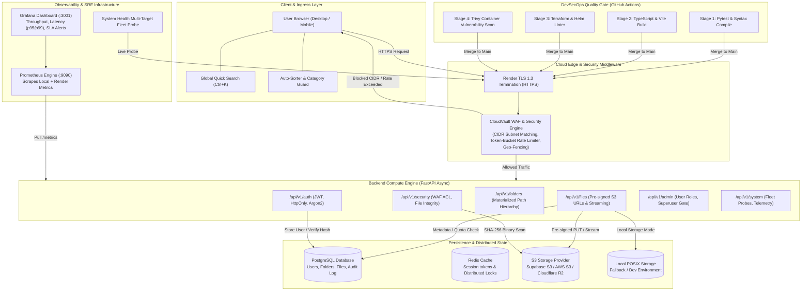

# ☁️ CloudVault: Enterprise Cloud Storage & DevSecOps Platform

<div align="center">

[](https://github.com/pogg144p/CloudVault/actions/workflows/ci.yml)
[](https://fastapi.tiangolo.com)
[](https://react.dev)
[](https://www.typescriptlang.org)
[](https://www.docker.com)
[](https://helm.sh)
[](https://www.terraform.io)
[](https://prometheus.io)
[](https://grafana.com)

**Architect & Owner:** Aakashdeep Dhall (`aakashdeep14122004@gmail.com`)  
**Live Production Frontend:** [https://cloudvault-frontend-z0wb.onrender.com](https://cloudvault-frontend-z0wb.onrender.com)  
**Live Production Backend API:** [https://cloudvault-backend-cazy.onrender.com](https://cloudvault-backend-cazy.onrender.com)  
**Interactive API Documentation:** [https://cloudvault-backend-cazy.onrender.com/docs](https://cloudvault-backend-cazy.onrender.com/docs)

</div>

---

## 📖 Overview

**CloudVault** is a production-grade, security-hardened cloud file storage and DevSecOps platform inspired by Google Drive and enterprise S3 file management systems. 

Unlike conventional toy file-upload projects, CloudVault was engineered to solve real enterprise infrastructure and distributed systems challenges:
* **Zero Backend I/O Bottleneck:** High-throughput streaming via AWS Signature v4 **Pre-signed S3 URLs** directly from client to cloud edge storage.
* **Active Cloud Security & WAF:** Integrated **Web Application Firewall (WAF)** with CIDR subnet blocking, regional Geo-Fencing, and an anti-DDoS **Token-Bucket Rate Limiter**.
* **Intelligent Auto-Sorter:** Automatic classification and routing of mixed batch uploads into designated category folders (`/Images/`, `/Videos/`, `/Documents/`, `/Music/`) with real-time category mismatch guard enforcement.
* **Cryptographic Data Integrity:** Real-time in-flight **SHA-256 digest computation** and an interactive on-demand **Integrity Inspector** to verify raw storage bytes against bit rot and tampering.
* **Hardened Dual-Token Auth:** **HttpOnly, Secure, SameSite=Lax** cookie-based JWT sessions with silent background auto-renewal and memory-hard **Argon2id** password hashing.
* **Full-Spectrum Observability:** Multi-target **Prometheus & Grafana** metrics pipeline monitoring both local Docker microservices and remote cloud instances simultaneously.
* **Cloud Infrastructure as Code:** Packaged with **Terraform AWS modules** (VPC, S3, RDS, EKS) and a production **Kubernetes Helm Chart** with Horizontal Pod Autoscaling (HPA).

---

## 🏗️ System Architecture



---

## ✨ Key Features & Capabilities

### 1. 📁 File & Folder Management
* **Materialized Path Hierarchy:** Folder genealogical lineages are stored in indexed paths (e.g., `/Design/Logos/2026/`), eliminating slow recursive SQL queries and enabling $O(1)$ sub-tree cascade operations.
* **Immutable Version History:** Overwriting or uploading new iterations appends records into `file_versions` with their own storage key for instant rollbacks.
* **Soft-Delete Recycle Bin:** Deleted files enter a 30-day recovery stage before automated background purging.
* **Full-Featured Previewer:** In-browser interactive preview for Images, PDFs, Videos, Audio, and Source Code / Markdown syntax viewing.
* **Granular Link Sharing:** Generate unique public tokens with custom permissions (`view` vs. `download`), password protection, and expiration timers.
* **Favorites System:** One-click star/unstar across Grid View, List View, Preview Modal, and Quick Search, consolidated under the dedicated **Favorites** tab.

### 2. ⚡ Intelligent Auto-Sorter & Category Guard
* **Batch Auto-Sort:** Uploading mixed files together automatically categorizes and routes them into their designated root folders:
  * Images (`.jpg, .png, .webp, .svg`) $\to$ `/Images/`
  * Documents (`.pdf, .docx, .txt, .xlsx, .pptx`) $\to$ `/Documents/`
  * Videos (`.mp4, .mov, .webm, .mkv`) $\to$ `/Videos/`
  * Music (`.mp3, .wav, .flac, .aac`) $\to$ `/Music/`
* **Category Mismatch Enforcement:** When uploading inside a specific category view (e.g. inside Images), if an incompatible file type is selected, an immediate alert modal appears with two explicit choices:
  * 🔴 **"Skip this file"** (Red Box): Skips the invalid file and uploads only compatible ones.
  * 🟢 **"Auto-Sort"** (Green Button): Automatically uploads and redirects the file to its proper designated category folder!

### 3. 🔍 Global Quick Search (Command Bar `Ctrl + K`)
* Spotlight/Raycast-inspired command palette accessible globally with `Ctrl + K` or `Cmd + K`.
* Live debounced query matching across file names, paths, and extensions.
* Category filter chips (`All`, `Documents`, `Images`, `Videos`, `Audio`, `★ Favorites`).
* Keyboard navigation (`↑`, `↓`, `Enter`) with immediate preview and folder jump capabilities.

### 4. 🛡️ Cloud Networking & WAF Security Center
* **CIDR Subnet Firewall:** Real-time IP and subnet blocking (e.g., `192.168.1.0/24` or known botnet origins).
* **Anti-DDoS Token-Bucket Rate Limiter:** 100-token capacity, 5 tokens/sec refill rate per client IP to mitigate volumetric and brute-force attacks.
* **Regional Geo-Fencing:** Simulates edge CDN geo-locking by restricting traffic to permitted ISO country codes.
* **Live Intrusion Stream:** Real-time tabular audit log tracking blocked attempts, client IPs, timestamps, and trigger reasons.
* **Cryptographic Tamper Detection:** Streams raw storage bytes from S3 and validates them against original in-flight SHA-256 checksums.

### 5. 🔐 Hardened Authentication & Administration
* **HttpOnly Dual-Token Session:** 30-minute Access Token + 7-day Refresh Token stored in `HttpOnly; Secure; SameSite=Lax` cookies (immune to XSS token exfiltration).
* **Silent Auto-Renewal:** Axios response interceptors catch 401s and refresh tokens seamlessly without interrupting user operations.
* **Argon2id Hashing:** Memory-hard password hashing impervious to GPU/ASIC brute-force cracking.
* **Admin Governance:** Superuser-only Admin tab to list all accounts, view quotas, and dynamically grant or revoke admin permissions.

---

## 📊 Observability & SRE Operations

* **Prometheus Metrics Engine (`/metrics`):**
  * `cloudvault_http_requests_total` (method, endpoint, status_code).
  * `cloudvault_http_request_duration_seconds` (latency percentiles: p50, p90, p95, p99).
  * `cloudvault_storage_used_bytes` & `cloudvault_registered_users_total`.
  * `cloudvault_security_blocks_total` (WAF and rate-limit trip counters).
* **Multi-Fleet Telemetry:** Scrapes both local microservices and remote live Render instances side-by-side.
* **Grafana SRE Dashboard (`:3001`):** Complete visualization panels for throughput, SLI/SLO error budgets, and SLA alert thresholds.
* **Chaos Engineering Simulator:** Injects artificial latency and fault errors (`500`) to test frontend error boundaries and Prometheus alert triggers.

---

## 🛠️ Technology Stack Summary

| Domain | Technology / Tool | Purpose |
| :--- | :--- | :--- |
| **Frontend** | React 18, TypeScript, Vite, Tailwind CSS | High-performance SPA with modern styling & strict typing |
| **Backend** | Python 3.11, FastAPI, Pydantic v2, Starlette | Async REST API engine with microsecond validation |
| **Database** | PostgreSQL, asyncpg, SQLAlchemy 2.0 | Async relational persistence & materialized path trees |
| **Caching** | Redis 7 | High-speed cache, session state & rate limiting |
| **Cloud Storage** | S3 API (Supabase Storage / AWS S3 / Cloudflare R2) | Distributed object storage with Pre-signed URLs |
| **Security** | Argon2id, PyJWT, Custom WAF Middleware | Memory-hard password hashing, HttpOnly cookies, CIDR WAF |
| **Containers** | Docker, Docker Compose | 6-service isolated local development cluster |
| **Orchestration**| Kubernetes, Helm Charts | Declarative deployments, Services, Ingress, and HPA autoscaling |
| **IaC** | Terraform (AWS Provider) | Modular infrastructure for VPC, S3, RDS, and EKS |
| **Monitoring** | Prometheus, Grafana | Pull-based telemetry, histograms, SLA alerts & dashboards |
| **CI/CD** | GitHub Actions, Trivy | 4-stage DevSecOps pipeline with container vulnerability scans |

---

## 🚀 Local Quickstart Guide (Docker Compose)

### Prerequisites
* [Docker Desktop](https://www.docker.com/products/docker-desktop/) (running)
* [Git](https://git-scm.com/)

### 1. Clone the Repository
```bash
git clone https://github.com/pogg144p/CloudVault.git
cd CloudVault
```

### 2. Launch the 6-Container Microservices Stack
```bash
docker compose up -d
```

### 3. Access Services
| Interface | URL | Credentials / Notes |
| :--- | :--- | :--- |
| **CloudVault Frontend** | `http://localhost:80` | Web Application UI |
| **Backend API & Swagger** | `http://localhost:8000/docs` | Interactive OpenAPI documentation |
| **Prometheus Telemetry** | `http://localhost:9090` | Time-series metrics engine |
| **Grafana SRE Dashboard** | `http://localhost:3001` | User: `admin` \| Pass: `admin` |
| **Health Check Endpoint** | `http://localhost:8000/health` | Service status JSON |

---

## 🔒 Security & Vulnerability Disclosures

CloudVault follows standard security best practices:
1. **Never store passwords in plain text:** Always hashed using Argon2id with high memory cost.
2. **Never expose tokens to JavaScript:** All JWTs reside in `HttpOnly` cookie jars.
3. **Never stream untrusted multi-GB uploads through compute instances:** Pre-signed S3 URLs transfer data directly to object storage.
4. **Automated Container Scans:** Every Docker image is scanned by **Aqua Security Trivy** in CI/CD to block deployments containing high/critical CVEs.

---

## 📜 License & Acknowledgments

This project is open-source under the [MIT License](LICENSE).  
Engineered with ❤️ by **Aakashdeep Dhall**.
